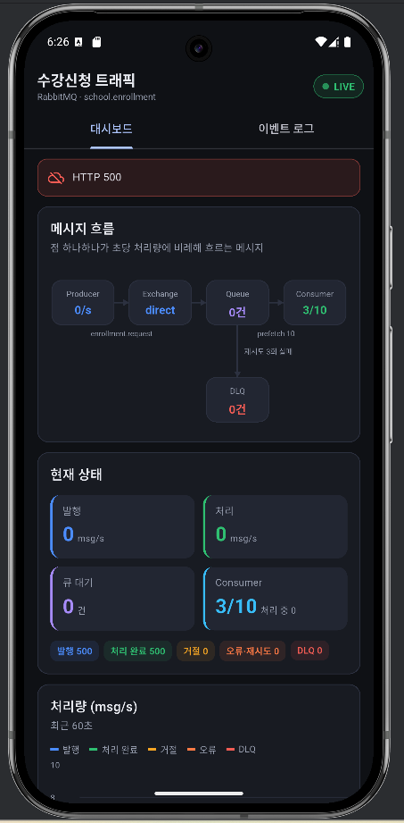
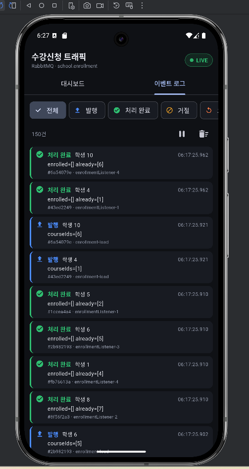
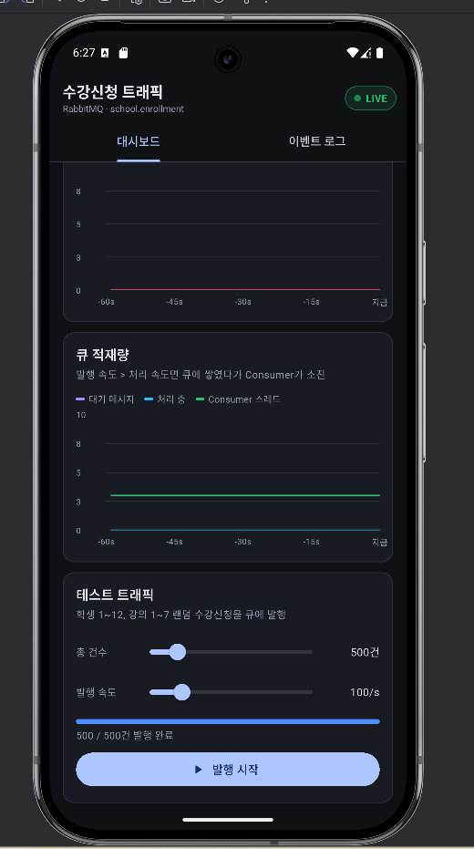

# school_traffic_monitor

changddao-back의 **수강신청 RabbitMQ 트래픽**을 Android 에뮬레이터에서 실시간으로 보는 Flutter 앱.

## 화면
- **대시보드 탭**: 메시지 흐름도(Producer → Exchange → Queue → Consumer / DLQ, 처리량만큼 점이 흐름), 핵심 수치, 처리량 차트, 큐 적재량 차트, 테스트 트래픽 발생 패널
- **이벤트 로그 탭**: 발행/완료/거절/오류/DLQ 이벤트 실시간 로그, 종류별 필터, 일시정지

## 폴더 구조 (feature-first)
```
lib/
├── main.dart                         ProviderScope로 앱 시작
├── app.dart                          MaterialApp, 테마, 첫 화면
├── core/                             기능과 무관한 공통 코드
│   ├── config/app_config.dart        서버 주소 (에뮬레이터 = 10.0.2.2)
│   ├── network/api_client.dart       Dio 인스턴스 + 에러 메시지 변환
│   ├── network/stomp_socket.dart     STOMP WebSocket 연결/재연결/구독
│   ├── theme/                        색상, 다크 테마
│   └── utils/formatters.dart         시간·숫자 포맷
└── features/
    └── enrollment_monitor/           수강신청 모니터 기능
        ├── data/                     ── 서버와 통신하는 계층
        │   ├── models/               JSON ↔ Dart 객체
        │   ├── datasources/
        │   │   ├── monitor_api.dart      REST  (/api/school/monitor/**)
        │   │   └── monitor_socket.dart   STOMP (/sub/school/monitor/**)
        │   └── repositories/
        │       └── monitor_repository.dart  REST + 소켓을 한 창구로
        └── presentation/             ── 화면 계층
            ├── controllers/          Riverpod Notifier (상태 + 로직)
            ├── screens/              화면 단위 위젯
            └── widgets/              재사용 위젯 (차트, 흐름도, 로그 ...)
```
의존 방향은 `presentation → data(repository) → datasources` 한 방향입니다.
새 기능(예: 학생 관리)을 붙일 때는 `features/student/` 아래에 같은 구조로 추가하면 됩니다.

## 백엔드 API
| 종류 | 경로 | 설명 |
|---|---|---|
| WS | `ws://<host>:8080/ws-school-monitor` | STOMP 엔드포인트 (SockJS 없음) |
| SUB | `/sub/school/monitor/traffic` | 1초마다 스냅샷 (처리량, 큐 대기, Consumer 수, 누적) |
| SUB | `/sub/school/monitor/events` | 1초마다 이벤트 묶음 (최대 50건) |
| GET | `/api/school/monitor/topology` | 익스체인지/큐 이름, concurrency, prefetch, 재시도 횟수 |
| GET | `/api/school/monitor/snapshot` | 최신 스냅샷 |
| GET | `/api/school/monitor/history?seconds=60` | 최근 N초 스냅샷 (최대 120) |
| GET | `/api/school/monitor/events?limit=50` | 최근 이벤트 (최대 200) |
| POST | `/api/school/monitor/load` | `{"count":500,"ratePerSecond":100}` 테스트 트래픽 시작 |
| DELETE | `/api/school/monitor/load` | 테스트 트래픽 중지 |
| GET | `/api/school/monitor/load` | 테스트 트래픽 진행 상태 |

## 실행 순서
1. RabbitMQ, MariaDB 컨테이너 실행 → Spring Boot(local 프로필) 실행
2. 이 폴더에서 Android 프로젝트 파일 생성 (lib/, pubspec.yaml은 그대로 유지됨)
   ```
   flutter create --org com.changho --project-name school_traffic_monitor --platforms android .
   flutter pub get
   ```
3. `android/app/src/main/AndroidManifest.xml`에서 두 군데 추가 (http/ws 평문 통신 허용)
   - `<application` 바로 위 줄에: `<uses-permission android:name="android.permission.INTERNET" />`
   - `<application` 태그 속성에: `android:usesCleartextTraffic="true"`
   ```xml
   <manifest xmlns:android="http://schemas.android.com/apk/res/android">
       <uses-permission android:name="android.permission.INTERNET" />
       <application
           android:usesCleartextTraffic="true"
           android:label="school_traffic_monitor"
           ...
   ```
4. IntelliJ에서 폴더 열기 → 에뮬레이터 선택 → Run
5. 대시보드 하단 **발행 시작**을 누르면 흐름도와 차트가 움직입니다.

실제 폰에서 실행할 때는 PC IP를 넘겨 주세요: `flutter run --dart-define=API_HOST=192.168.0.10`

<p align="center">
  
  
  
</p>